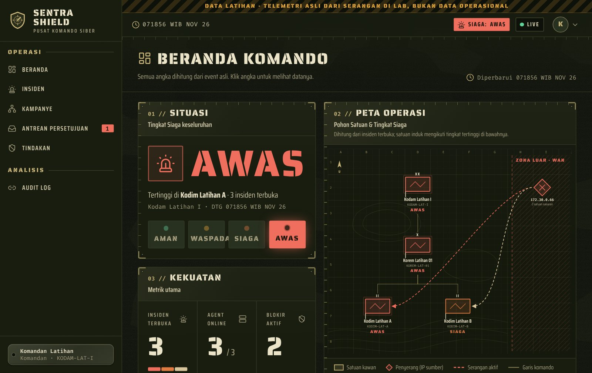
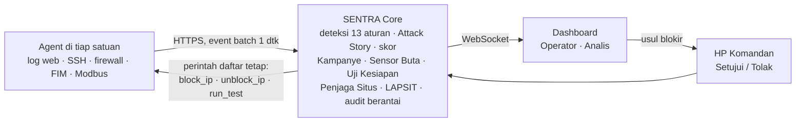

# SENTRA SHIELD — Smart Cyber Threat Detection & Monitoring System

Pusat komando deteksi dan respons ancaman siber berbasis web untuk satuan TNI AD. Sensor ringan dipasang di tiap satuan. Pusat berbasis Laravel merangkum ratusan event menjadi satu insiden yang bisa dijelaskan. Respons mengikuti rantai komando: Operator mengusulkan, Komandan menyetujui dari HP, dan agent memblokir penyerang di firewall.

Karya untuk **Kartika Cyber Hackathon 2026**, kategori 02 Penangkalan (Defensive Shield).

| | |
|---|---|
| **Link karya** | Landing page: `https://zuliandwisaputra17-stack.github.io/SENTRA-SHIELD-Smart-Cyber-Threat-Detection-Monitoring-System/` (diterbitkan dari folder [`site/`](site/)) |
| **Video presentasi** | menyusul (disematkan di landing page) |
| **Slide** | menyusul |

> **Nyata** — setiap deteksi berasal dari telemetri asli, dan blokir benar-benar memutus penyerang dari mesin terpisah. Tidak ada data atau angka karangan di dashboard.
> **Terukur** — sistem menguji dirinya sendiri (Uji Kesiapan) dan menampilkan cakupan deteksi serta waktu deteksi dalam angka.
> **Siap pakai** — satu perintah menyalakan seluruh lab; berjalan penuh tanpa internet setelah image dan model diunduh sekali; cukup di mini-PC.



*Tangkapan layar berisi DATA LATIHAN: telemetri asli dari serangan di lab, nama satuan fiktif.*

## Masalah yang diselesaikan

1. Satuan setingkat Kodim/Korem jarang punya analis siber khusus, sehingga log tersebar dan tidak pernah dibaca.
2. Alat keamanan biasa membanjiri operator dengan alert mentah tanpa konteks.
3. Respons tidak mengikuti rantai komando, dan bukti mudah berubah atau hilang.
4. Serangan terkoordinasi ke beberapa satuan tidak terlihat bila tiap satuan dipantau terpisah.
5. Penyerang mematikan sensor atau log lebih dulu, sehingga pertahanan buta tanpa disadari.

## Cara kerja



Rincian komponen, alur data, API agent, katalog aturan, rumus skor, dan desain keamanan: **[docs/arsitektur.md](docs/arsitektur.md)**.

## Sudah jalan vs peta jalan

| Kemampuan | Status |
|---|---|
| **F1–F2** Agent Python tanpa dependensi: log web, SSH, firewall nftables (NFLOG, cadangan raw socket), FIM, sensor Modbus pasif; antrean lokal 10.000 event saat Core putus; kode pendaftaran sekali pakai, token bisa dicabut | ✅ Diuji dengan nmap, hydra, sqlmap, unggah webshell, dan tulis Modbus dari container penyerang |
| **F3** Mesin deteksi 13 aturan (pola + ambang) dengan teknik MITRE ATT&CK, daftar putih IP, aturan bisa diubah Admin | ✅ |
| **F4–F5** Korelasi Attack Story per tahap kill chain; skor dengan rumus terbuka, severity, dan Tingkat Siaga satuan | ✅ ±970 event serangan ke Kodim A → 1 insiden, 11 aturan, 4 tahap, skor 946 Kritis |
| **F6** Beranda Komando live: metrik, feed event, grafik event per menit, pohon satuan; setiap angka bisa diklik ke buktinya | ✅ WebSocket (event tampil ±2 detik), cadangan polling 3 detik |
| **F7** Respons berjenjang: usul → setuju/tolak dari HP → blokir di nftables; rollback, kedaluwarsa otomatis, riwayat | ✅ Penyerang terputus 2,7–4,0 detik setelah Komandan menyetujui |
| **F8** Uji Kesiapan: 11 skenario aman ke host sendiri, matriks hasil, cakupan, rata-rata waktu deteksi, riwayat | ✅ 11/11, rata-rata 4,2–4,7 detik, tanpa insiden palsu |
| **F9** Sensor Buta: heartbeat hilang > 30 detik → agent BUTA + insiden Tinggi; sumber log rutin yang diam → peringatan | ✅ Alarm ±40 detik setelah agent dimatikan (batas 30 detik + pemeriksaan tiap 10 detik) |
| **F10** Kampanye lintas satuan: IP sama di ≥ 2 satuan dalam 24 jam → skor ×1,3, blokir serentak sekali setuju | ✅ |
| **F11** Audit log berantai SHA-256 + halaman Audit Log dengan tombol Verifikasi Rantai | ✅ Baris yang diubah/dihapus langsung di database ditunjukkan nomornya |
| **F12** LAPSIT: LLM lokal (Ollama `qwen2.5:3b`) dari fakta JSON, sitasi `[EV-n]` divalidasi, cadangan template, PDF ber-hash, ekspor tercatat | ✅ Template ±2 detik; jalur LLM dan batas waktu 60 detik diuji dengan Ollama tiruan. Model asli perlu diuji di laptop demo |
| **F13** Penjaga Situs: 3 varian (browser, Googlebot, referer Google) → injeksi judi online ber-cloaking (R13) dan defacement di luar jadwal (R10) | ✅ Injeksi judol ke portal lab terdeteksi (kemiripan versi Googlebot 7%, 8 kata judi) |
| **F15** Mode demo read-only: akun Demo hanya melihat, label DATA LATIHAN di setiap halaman, landing page dengan video dan screenshot | ✅ Tanpa server publik (tidak ada VPS); juri membuka landing page atau menjalankan lab sendiri |
| Pengaturan (durasi blokir default, alamat/model/batas waktu Ollama) | ✅ |
| **F14** Persetujuan lewat Telegram (bonus) | ❌ Tidak dikerjakan |
| Mode Latihan (replay), impor IOC offline, protokol OT tambahan (S7comm, DNP3) | 🗺️ Peta jalan jangka pendek |
| LAPSIT berjenjang Kodim → Kodam → Pusat, anomali berbasis baseline per satuan, integrasi firewall perimeter | 🗺️ Peta jalan jangka menengah |
| Uji coba di satu satuan nyata bersama PUSSIBERAD, sertifikasi keamanan, agent untuk Windows | 🗺️ Peta jalan jangka panjang |

Semua angka di atas diukur dari lab latihan pada 6–7 November 2026 (lab pengembang dan laptop demo Windows 11 + Docker Desktop/WSL2). Uji kernel di laptop demo: log firewall NFLOG dan blokir nftables lulus 6/6.

## Menjalankan lab demo

**Windows 11:** ikuti [panduan pemula Windows](docs/panduan-pemula-windows.md), lalu klik dua kali file di `lab\windows`: `mulai-lab.bat` (menyalakan lab), `jalankan-demo.bat` (skenario demo bertahap), `cek-lab.bat`, `reset-lab.bat`, `matikan-lab.bat`. Tidak perlu mengetik perintah. Taruh kode di luar folder OneDrive.

**Linux/macOS:** butuh Docker dengan Compose v2, RAM kosong ±3 GB, dan port `8443` bebas.

```bash
git clone -b claude/pensive-galileo-eow7qv https://github.com/zuliandwisaputra17-stack/SENTRA-SHIELD-Smart-Cyber-Threat-Detection-Monitoring-System.git
```

```bash
cd SENTRA-SHIELD-Smart-Cyber-Threat-Detection-Monitoring-System
```

```bash
docker compose -f lab/docker-compose.yml up -d --build
```

```bash
bash lab/cek-lab.sh
```

Buka **https://localhost:8443**. Sertifikat dibuat CA lab sendiri, jadi lanjutkan peringatan browser. Lab memuat Core, MySQL, dua satuan dengan portal dummy "LINGKUNGAN LATIHAN", PLC simulasi, dan mesin penyerang terpisah; agent mendaftar sendiri. Skenario serangan, topologi, dan reset: [lab/README.md](lab/README.md).

**Sistem berjalan offline setelah image Docker dan model LLM ditarik sekali.** Build pertama membutuhkan internet untuk image dasar, apt, composer, dan npm.

### LLM lokal untuk LAPSIT (opsional)

Tanpa LLM, LAPSIT dibuat dari template. Untuk memakai LLM lokal (±4–5 GB sekali unduh, RAM tambahan ±3 GB), di Windows klik `lab\windows\siapkan-llm.bat`; di Linux:

```bash
docker compose -f lab/docker-compose.yml --profile llm up -d
```

```bash
docker compose -f lab/docker-compose.yml exec ollama ollama pull qwen2.5:3b
```

Setelah itu sertakan `--profile llm` saat `up` dan `down`. Reset data lab (`--profile llm down`, lalu `down -v` tanpa profile) tidak menghapus model.

### Akun lab bawaan

Kata sandi awal semua akun: `Latihan#2026` (ubah lewat `SENTRA_SEED_PASSWORD`). Hanya untuk lab: ganti kata sandi bila dipakai di luar lab.

| Email | Peran | Satuan | Bisa |
|---|---|---|---|
| `operator.a@sentra.lab` | Operator | Kodim Latihan A | melihat satuannya, ubah status insiden, usul tindakan |
| `operator.b@sentra.lab` | Operator | Kodim Latihan B | sama, untuk Kodim B |
| `analis@sentra.lab` | Analis | Kodam Latihan I | lintas satuan, usul tindakan, LAPSIT, Uji Kesiapan, Penjaga Situs, audit |
| `komandan@sentra.lab` | Komandan | Kodam Latihan I | setuju/tolak tindakan (juga dari HP), LAPSIT, audit |
| `admin@sentra.lab` | Admin | Kodam Latihan I | satuan, agent, pengguna, aturan, pengaturan, Uji Kesiapan, audit |
| `demo@sentra.lab` | Demo | Kodam Latihan I | hanya melihat, tanpa aksi apa pun |

Seeder hanya membuat data master (satuan, akun, aturan, pengaturan). Seeder **tidak** membuat event, insiden, atau angka apa pun: semua yang tampil di dashboard berasal dari telemetri agent.

## Batasan yang diakui

- Deteksi berbasis aturan dan ambang, belum machine learning; akurasi diukur di lab, bukan di jaringan produksi.
- Sensor OT baru Modbus TCP, dan berjalan pada PLC simulasi.
- Lab berjalan di satu laptop; jaringan satuan diemulasikan dengan jaringan Docker terpisah.
- Blokir dilakukan di firewall host agent, belum di firewall perimeter atau switch.
- LAPSIT dari LLM adalah draf yang tetap perlu diperiksa Analis.
- Tidak ada demo publik daring (tidak ada VPS); link karya berupa landing page dengan video dan tangkapan layar.

## Struktur repo

```
core/    aplikasi Laravel (Core + Command), Dockerfile, test Pest
agent/   sentra_agent.py, install.sh, config.example.json, unit systemd, test (Python, pustaka standar saja)
lab/     docker-compose.yml, target satuan, PLC simulasi, penyerang, skrip Windows, spike nftables
docs/    arsitektur, keputusan desain, panduan pemula Windows, bukti demo
site/    landing page statis untuk link karya (GitHub Pages)
```

## Stack

Laravel 13 (PHP 8.3), MySQL 8.4, Blade + Livewire 3 + Tailwind CSS + Chart.js, Laravel Breeze (login), Laravel Sanctum (token agent), Laravel Reverb (realtime, dengan cadangan polling), Dompdf (PDF LAPSIT), Ollama (LLM lokal, opsional), agent Python 3.10+ tanpa dependensi eksternal, image lab berbasis Ubuntu 24.04.

Tidak ada font, CDN, atau layanan cloud yang dimuat saat runtime.

## Pengembangan dan test

Test otomatis: Core (Pest, MySQL 8) dan agent (unittest pustaka standar). Test Core memakai database `sentra_test`:

```bash
docker run -d --name sentra-mysql -e MYSQL_ROOT_PASSWORD=root -e MYSQL_DATABASE=sentra -e MYSQL_USER=sentra -e MYSQL_PASSWORD=sentra -p 127.0.0.1:3306:3306 mysql:8.4
```

Tunggu sekitar 20 detik sampai MySQL siap:

```bash
docker exec sentra-mysql mysql -uroot -proot -e "CREATE DATABASE IF NOT EXISTS sentra_test; GRANT ALL ON sentra_test.* TO 'sentra'@'%';"
```

```bash
cd core && composer install && npm ci && npm run build && cp .env.example .env && php artisan key:generate && php artisan migrate:fresh --seed && php artisan test
```

Test agent, dari root repo:

```bash
python3 -m unittest discover -s agent/tests -v
```

Menjalankan Core tanpa Docker (setelah langkah di atas): `php artisan serve`, lalu buka http://127.0.0.1:8000. Kebutuhan: PHP 8.3+ (ekstensi `pdo_mysql`, `mbstring`, `xml`, `curl`, `zip`, `intl`), Composer 2, Node.js 20+.

## Dokumentasi

- [Arsitektur](docs/arsitektur.md): komponen, alur data, API agent, katalog aturan, rumus skor, desain keamanan.
- [Keputusan desain](docs/keputusan-desain.md): hal yang menyimpang dari atau memperjelas PRD, beserta alasannya.
- [Panduan pemula Windows](docs/panduan-pemula-windows.md): pasang WSL, Docker Desktop, dan Git, lalu jalankan lab dengan skrip klik-dua-kali.
- [Lab demo](lab/README.md): topologi, skenario serangan, reset.
- [Agent](agent/README.md): sumber telemetri, perintah daftar tetap, Uji Kesiapan, pemasangan di host nyata.
- [Spike nftables](lab/spike/nftables/README.md): bukti log firewall dan blokir dari dalam container.
- [Landing page](site/README.md): memasang video dan menerbitkan ke GitHub Pages.
- [Sistem desain](docs/design-system.md): gaya Olive Drab / Ops Darat — token warna (severity dan Tingkat Siaga), font stensil, elemen militer, tata letak sidebar, aksesibilitas, dan komponen Blade.

## Pernyataan karya dasar

Proyek ini dibangun di atas perangkat lunak sumber terbuka yang sudah ada:

- **Berlisensi MIT:** kerangka aplikasi Laravel, Laravel Breeze (scaffolding login, tampilan Livewire/Volt), Livewire, Laravel Sanctum, Laravel Reverb, Tailwind CSS dan @tailwindcss/forms, Chart.js, Laravel Echo, pusher-js, barryvdh/laravel-dompdf, serta Pest (hanya untuk test).
- **Berlisensi LGPL (dipakai sebagai pustaka, tidak diubah):** Dompdf beserta php-font-lib dan php-svg-lib, untuk PDF LAPSIT. Font DejaVu ikut paket Dompdf.
- **Layanan opsional yang dijalankan terpisah:** Ollama (MIT). Model bawaan Qwen2.5-3B memakai lisensi Qwen Research dari pembuatnya (penggunaan non-komersial); model bisa diganti di halaman Pengaturan.
- **Komponen sistem di image lab** (lisensi masing-masing): Ubuntu 24.04, MySQL 8.4, nginx, PHP-FPM, OpenSSH, nftables, supervisor.
- **Hanya dipakai di lab** (lisensi masing-masing): pymodbus untuk PLC simulasi; nmap, hydra, sqlmap, dan curl untuk mesin penyerang.
- **Aset tampilan, dibundel lokal (tanpa CDN):** huruf Saira Stencil One, Saira Condensed, dan Fira Code (SIL Open Font License 1.1, lewat paket @fontsource; salinan untuk landing page di `site/fonts` beserta lisensinya); ikon Lucide (ISC, lewat lucide-static, disalin sebagai SVG inline). Tekstur kanvas, loreng, grid peta, dan simbol satuan adalah SVG buatan sendiri.
- **Alat bantu desain saat pengembangan, tidak ikut berjalan di aplikasi:** skill ui-ux-pro-max (MIT) di `.claude/skills/ui-ux-pro-max` dan frontend-design, dipakai untuk mencari rekomendasi sistem desain (lihat [docs/design-system.md](docs/design-system.md)).
- **Rujukan:** MITRE ATT&CK Enterprise dan ATT&CK for ICS untuk pemetaan teknik.

Logika SENTRA SHIELD ditulis untuk lomba ini: agent dan sensornya, mesin deteksi dan korelasi, rumus skor, respons berjenjang, Sensor Buta, Kampanye, Uji Kesiapan, Penjaga Situs, LAPSIT dan validasi sitasinya, audit log berantai, dashboard beserta sistem desain dan tanda SENTRA SHIELD (rancangan sendiri, bukan lambang resmi mana pun), lab demo, dan skrip Windows.

## Lisensi

[MIT](LICENSE)
