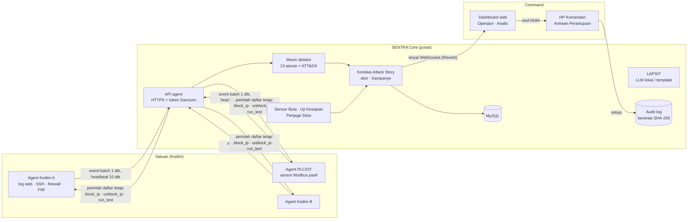

# Arsitektur SENTRA SHIELD

Dokumen ini menjelaskan bagian-bagian sistem, alur data, aturan deteksi, rumus skor, dan desain keamanannya. Keputusan yang menyimpang dari atau memperjelas PRD dicatat di [keputusan-desain.md](keputusan-desain.md).

## Gambaran besar



| Bagian | Isi | Teknologi |
|---|---|---|
| **Agent** | Sensor di host satuan: log web (nginx/apache), log SSH, firewall nftables (NFLOG, cadangan raw socket), integritas file (FIM), sensor Modbus TCP pasif. Menjalankan perintah daftar tetap. | Python 3.10+ pustaka standar saja, satu file `agent/sentra_agent.py`, konfigurasi JSON |
| **Core** | API agent, mesin deteksi, korelasi, skor, Kampanye, Sensor Buta, Uji Kesiapan, Penjaga Situs, LAPSIT, audit log, scheduler. | Laravel 13 (PHP 8.3), MySQL 8.4, antrean database, Reverb |
| **Command** | Dashboard web berbahasa Indonesia, mode gelap, responsif di HP. | Blade + Livewire 3 + Tailwind CSS + Chart.js |

Semua berjalan tanpa internet: tidak ada font, CDN, atau layanan cloud yang dimuat saat runtime. LLM untuk LAPSIT berjalan lokal lewat Ollama (opsional).

## Alur sebuah serangan

1. **Telemetri.** Agent membaca log dan paket, menormalkan setiap kejadian ke skema event, menyimpannya di antrean SQLite lokal (maks 10.000 baris), lalu mengirim batch tiap 1 detik lewat HTTPS. Bila Core tidak bisa dihubungi, event ditahan dan dikirim ulang.
2. **Penyimpanan.** Core menyimpan event satu per satu dalam satu transaksi (ID setiap event pasti diketahui) lalu menjadwalkan job `ProcessEvents`.
3. **Deteksi.** Setiap event dicocokkan ke aturan aktif. Aturan pola menghasilkan satu deteksi per event yang cocok; aturan ambang menghasilkan satu deteksi per (aturan, satuan, IP) per jendela waktu. IP di daftar putih dilewati.
4. **Korelasi.** Deteksi ber-IP masuk ke insiden terbuka di satuan yang sama dengan IP yang sama dalam 30 menit terakhir, atau membuat insiden baru. Deteksi tanpa IP (FIM, Penjaga Situs) ditautkan menurut waktu ke insiden terbuka paling baru di satuan itu, dengan label "Atribusi berdasarkan waktu".
5. **Skor dan Tingkat Siaga.** Skor insiden dihitung ulang, severity diturunkan dari skor, dan Tingkat Siaga satuan mengikuti severity tertinggi insiden terbukanya (satuan induk mengikuti anak tertinggi).
6. **Kampanye.** IP yang sama di dua satuan atau lebih dalam 24 jam membentuk Kampanye; skor setiap insiden tertaut dikali 1,3.
7. **Tampilan.** Core menyiarkan *sinyal* (jenis perubahan + ID satuan, tanpa data) lewat WebSocket. Setiap halaman mengambil ulang datanya sesuai hak akses pengguna; bila WebSocket putus, browser memperbarui tiap 3 detik.
8. **Respons.** Operator/Analis mengusulkan blokir; Komandan menyetujui atau menolak. Perintah `block_ip` diambil agent (tiap 3 detik), dipasang di set nftables dengan `timeout`, dan hasilnya dilaporkan balik. Blokir terbuka sendiri saat durasi habis, walau Core mati.
9. **Bukti.** Setiap aksi penting tercatat di audit log berantai; LAPSIT bisa diterbitkan dan diekspor ke PDF ber-hash.

## API agent (`/api/v1/agent`)

| Metode | Path | Fungsi |
|---|---|---|
| POST | `/register` | Tukar kode pendaftaran sekali pakai (berlaku 24 jam) dengan token. Dibatasi 10/menit per IP. |
| POST | `/heartbeat` | Lapor hidup, versi, IP, status tiap sumber log. Tiap 10 detik. |
| POST | `/events` | Kirim batch event (maks 500). |
| GET | `/commands` | Ambil perintah yang sudah disetujui. |
| POST | `/commands/{id}/result` | Lapor hasil eksekusi perintah. |

Semua endpoint selain `/register` memakai `Authorization: Bearer <token>` (token Sanctum, disimpan ter-hash) dan dibatasi 600 permintaan/menit per agent. Respons: 401 bila token salah atau dicabut, 422 bila skema event tidak valid, 429 bila melewati batas.

## Aturan deteksi

| Kode | Nama | Sumber | Jenis | Tahap | Bobot | MITRE ATT&CK | Ringkasan logika |
|---|---|---|---|---|---|---|---|
| R01 | Pemindaian port | firewall | ambang | Pengintaian | 20 | T1046 | ≥ 15 port tertutup berbeda dalam 60 dtk dari satu IP |
| R02 | Alat pemindai web | web | pola | Pengintaian | 15 | T1595.002 | user agent nikto, sqlmap, nmap, gobuster, wpscan |
| R03 | Brute force direktori | web | ambang | Pengintaian | 15 | T1595.003 | ≥ 30 respons 404 dalam 60 dtk |
| R04 | SQL injection | web | pola | Akses Awal | 35 | T1190 | `union select`, `' or '1'='1`, `sleep(`, `--` (setelah URL-decode dua kali) |
| R05 | XSS | web | pola | Akses Awal | 25 | T1190 | `<script`, `onerror=`, `javascript:` |
| R06 | Path traversal / LFI | web | pola | Akses Awal | 35 | T1190 | `../`, `/etc/passwd`, `php://filter` |
| R07 | Brute force SSH | ssh | ambang | Akses Awal | 30 | T1110.001 | ≥ 10 login gagal dalam 60 dtk |
| R08 | Login berhasil setelah brute force | ssh | pola | Akses Awal | 50 | T1078 | login berhasil dari IP yang memicu R07 dalam 30 menit |
| R09 | Webshell | fim | pola | Eksekusi/Persistensi | 60 | T1505.003 | file `.php` dibuat/diubah berisi `eval(`, `base64_decode(`, `system($_` |
| R10 | Defacement | fim / situs | pola | Dampak | 50 | T1491.001 | halaman utama berubah di luar jadwal pembaruan |
| R11 | Perintah tulis Modbus tanpa izin | modbus | pola | Dampak | 60 | T0855 (ICS) | FC 5, 6, 15, 16 dari luar daftar HMI |
| R12 | Sensor Buta | heartbeat | ambang | Pertahanan dilumpuhkan | 80 | T1562.001 | heartbeat hilang > 30 dtk |
| R13 | Injeksi judi online ber-cloaking | situs | pola | Dampak | 45 | T1491.002 | versi Googlebot/referer Google kemiripannya < 0,8 dengan versi browser dan memuat kata judi yang tidak ada di versi browser |

Admin dapat menonaktifkan aturan, mengubah bobot, ambang, dan jendela waktu, serta mengelola daftar putih IP/CIDR. Bobot R12 diubah dari 40 (PRD) menjadi 80 atas persetujuan pemilik proyek, agar Sensor Buta tetap Tinggi.

## Rumus skor

```
S = ( Σ bobot aturan unik  +  20 × (T − 1) ) × m_aset × m_kampanye
```

- **Σ bobot aturan unik**: setiap aturan dihitung sekali per insiden, walau terpicu berkali-kali.
- **T**: jumlah tahap kill chain yang tercapai.
- **m_aset**: OT (PLC/HMI) 1,5; server web 1,2; lainnya 1,0. Diambil dari aset tertinggi yang terlibat; situs yang dipantau dihitung server web.
- **m_kampanye**: 1,3 bila insiden bagian dari Kampanye, selain itu 1.
- **Severity**: Rendah 0–39, Sedang 40–79, Tinggi 80–149, Kritis ≥ 150. Skor dibulatkan ke bilangan bulat terdekat.

Contoh dari lab (insiden Kodim A setelah skenario penuh): (425 + 20 × 3) × 1,5 × 1,3 = **946, Kritis**. Rincian per komponen tampil di Detail Insiden.

## Fitur Tingkat 2

| Fitur | Cara kerja singkat |
|---|---|
| **Uji Kesiapan** | Core mengirim `run_test` (token acak per uji) ke agent yang sumber telemetrinya aktif. Agent menjalankan 11 skenario aman ke host-nya sendiri (loopback, akun SSH uji, port uji, file uji, register Modbus uji, jeda heartbeat). Event bertanda `is_test` tidak pernah menjadi insiden. Core mencocokkan deteksi uji ke skenario dan menghitung cakupan serta waktu deteksi. |
| **Sensor Buta** | Scheduler tiap 10 detik memeriksa heartbeat. Agent tanpa heartbeat > 30 dtk dinyatakan BUTA dan insiden Sensor Buta dibuat per agent. Sumber log yang biasanya aktif (event di ≥ 30 dari 60 menit) tetapi diam > 5 menit diberi peringatan. Agent yang hidup kembali tercatat di garis waktu. |
| **Kampanye** | Lihat alur nomor 6. Dari halaman Kampanye, blokir serentak ke semua satuan terdampak cukup satu persetujuan. |
| **Audit log** | Setiap baris menyimpan `hash = SHA-256(prev_hash + JSON kanonik isi baris)`. Penulisan diserialkan dengan named lock MySQL. Verifikasi menghitung ulang seluruh rantai dan menunjukkan baris pertama yang rusak. |
| **LAPSIT** | Diproses di antrean terpisah. Prompt ke Ollama hanya berisi fakta insiden (JSON). Keluaran JSON terstruktur divalidasi: sitasi `[EV-n]` palsu, butir temuan tanpa bukti, dan IP di luar fakta dibuang. Bila Ollama tidak ada, > 60 dtk, atau keluarannya gagal validasi, LAPSIT disusun dari template. PDF memuat SHA-256 isi di kaki halaman; SHA-256 file PDF disimpan di database dan audit log. |
| **Penjaga Situs** | Tiap menit Core mengambil halaman situs terdaftar sebagai browser, Googlebot, dan dengan referer Google; teks yang terlihat dibandingkan (Jaccard) dan dicari kata kunci judi. Hanya situs terdaftar di jaringan privat (bawaan), pengalihan tidak diikuti. |

## Desain keamanan

- **Perintah daftar tetap.** Agent hanya mengenal `block_ip`, `unblock_ip`, `run_test`. Parameter divalidasi (IP valid, bukan loopback/multicast, durasi 60 dtk–24 jam); `nft` dipanggil dengan argumen tetap tanpa shell. Tidak ada eksekusi perintah bebas.
- **Two-person rule.** Pengusul dan pemutus tindakan tidak boleh orang yang sama; Komandan tidak bisa mengusulkan, Operator/Analis tidak bisa menyetujui.
- **Hak akses.** Lima peran (Operator, Analis, Komandan, Admin, Demo) sesuai matriks PRD; Operator hanya melihat satuannya dan satuan di bawahnya. Siaran WebSocket tidak membawa data.
- **Token agent** dibuat dari kode pendaftaran sekali pakai, disimpan ter-hash, bisa dicabut dan langsung ditolak API.
- **HTTPS** dengan CA lab sendiri; agent memverifikasi sertifikat dan tidak pernah mematikan verifikasi.
- **Bukti tidak bisa diubah dari UI.** Event mentah tidak bisa diedit; audit log hanya ditambah, dan perubahan langsung di database terdeteksi.
- **Uji aman.** Skenario Uji Kesiapan hanya ke host sendiri dan hanya ditandai uji bila tidak bisa dipalsukan dari luar (token acak + loopback). Penjaga Situs hanya memeriksa situs terdaftar.
- **Data tidak keluar jaringan.** LLM berjalan lokal; tidak ada layanan cloud.

## Skema database

Tabel utama sesuai PRD bagian 8: `units`, `users`, `agents`, `events`, `detection_rules`, `detections`, `incidents`, `campaigns`, `actions`, `audit_logs`, `readiness_runs`, `readiness_results`, `monitored_sites`, `site_checks`, `reports`, ditambah `settings` dan tabel bawaan Laravel (sesi, cache, antrean, token). Kolom pelengkap dan alasannya ada di [keputusan-desain.md](keputusan-desain.md#kolom-pelengkap-di-skema). Waktu disimpan dalam UTC dengan presisi milidetik dan ditampilkan dalam WIB.

## Lab demo

| Container | Peran | Jaringan |
|---|---|---|
| `sentra-core` | Core + nginx HTTPS (port 8443) + php-fpm + 2 worker antrean + scheduler + Reverb | net-pusat 172.31.0.2 |
| `mysql` | Database | net-pusat |
| `kodim-a`, `kodim-b` | Portal dummy "LINGKUNGAN LATIHAN" (sengaja rentan) + sshd + agent | net-kodim-*, net-wan, net-pusat |
| `plc-sim` | PLC simulasi Modbus TCP + agent sensor OT | net-kodim-a, net-wan, net-pusat |
| `attacker` | nmap, hydra, sqlmap, curl, klien Modbus; IP tetap 172.30.0.66 | hanya net-wan |
| `ollama` | LLM lokal (opsional, `--profile llm`) | net-pusat |

Topologi, skenario serangan, dan reset: [lab/README.md](../lab/README.md).
